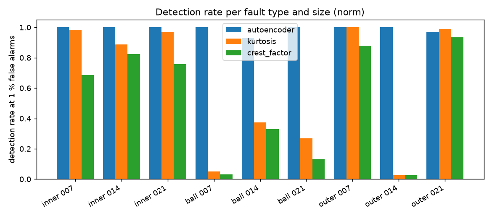

# Edge Anomaly Node

A battery-powered vibration sensor node that decides **on the microcontroller** whether a bearing sounds healthy, using a 7k-parameter autoencoder quantised to int8 (25 KB). Trained only on healthy data, so it needs no labelled failures.

**Status: phase 1 of 4 complete** (model, evaluation, TFLite int8 export). Firmware, networking and power measurement follow.

| Phase | What | State |
| --- | --- | --- |
| 1 | Anomaly model on real bearing data, int8 TFLite export, honest evaluation against hand-crafted baselines | done |
| 2 | ESP32 + MPU6050 firmware running the model with TFLite Micro; measured latency and RAM | planned |
| 3 | MQTT reporting, deep sleep, measured current draw and battery-life estimate | planned |
| 4 | Demo video, CI on firmware, write-up | planned |

## Results (phase 1)

Evaluated on 4 330 test windows from the [CWRU bearing dataset](https://engineering.case.edu/bearingdatacenter): healthy windows the model never saw, plus nine fault recordings (inner race, ball, outer race × 0.007 / 0.014 / 0.021 in). The alarm threshold is set at the 99th percentile of healthy validation windows; no fault data is used to tune anything.

**Shape-only detection** (each window normalised to zero mean / unit variance, so amplitude cannot be the cue):

| Detector | ROC-AUC | Detection rate | False alarms | Ball-fault 0.014 in |
| --- | --- | --- | --- | --- |
| **Autoencoder (int8, 25 KB)** | **0.997** | **98.9 %** | 4.3 % | 93 % |
| Kurtosis threshold | 0.789 | 61.6 % | 2.1 % | 37 % |
| Crest-factor threshold | 0.765 | 51.1 % | 4.3 % | 33 % |



The single-feature detectors catch inner-race faults but miss most ball faults and the 0.014 in outer-race fault; the autoencoder catches all of them. int8 quantisation changed the AUC by less than 0.001 and halved the model size (43 KB → 25 KB).

**With absolute amplitude kept** (`--variant abs`): every detector, including a plain RMS threshold, scores AUC 1.000. On this test rig a faulty bearing simply vibrates several times harder, so amplitude alone solves the lab dataset. It is also the least portable cue (it shifts with load, sensor mounting and gain), which is why the shape-only result above is the one that matters and the one the firmware will use.

More figures: [ROC](docs/figures/roc_norm.png) · [error distribution](docs/figures/error_hist_norm.png) · [example reconstructions](docs/figures/reconstructions_norm.png).

## Two data pitfalls worth knowing about

Both would have made the numbers look better than they are.

1. **The healthy recording is sampled at 48 kHz, the fault recordings at 12 kHz.** CWRU does not label it clearly; the 1797 rpm shaft line lands at 29.95 Hz only under the 48 kHz reading, and CWRU's other baseline files have exactly the 48 kHz record length. The baseline is decimated by 4 before windowing.
2. **Decimation leaves a different band edge than native 12 kHz acquisition.** With that artefact present the autoencoder scored a perfect 1.000 in shape-only mode; after low-passing every recording at the same 4 kHz it drops to 0.997. The lower number is the honest one, and the pipeline applies the common filter to everything.

## How it works

```
256-sample window (21 ms @ 12 kHz)
   │  zero-mean / unit-variance
   ▼
Conv1D 8 ─ Conv1D 16 ─ Conv1D 16 ─ Conv1D 1   (stride-2 encoder → 32-value code)
   ▼
Conv1DT 16 ─ Conv1DT 16 ─ Conv1DT 8 ─ Conv1D 1 (decoder → 256 samples)
   │
   ▼  mean squared reconstruction error  >  threshold  →  ALARM
```

The autoencoder is trained to reproduce healthy vibration. Windows that look like healthy vibration reconstruct well; anything else does not. ReLU only, no batch-norm, 7 234 parameters, so the full-integer graph stays simple for TFLite Micro.

Split: the healthy recording is cut *in time* (60 % train / 20 % validation / 20 % test) so overlapping windows never leak across the split. Fault recordings are test-only.

## Repository

```
ml/
  data.py            CWRU loading, resampling, common low-pass, windowing, abs/norm variants
  features.py        RMS, kurtosis, crest factor (baseline detectors)
  model.py           1-D conv autoencoder
  train.py           python -m ml.train --variant norm
  evaluate.py        python -m ml.evaluate --variant norm     → metrics_<variant>.json + figures
  export_tflite.py   python -m ml.export_tflite --variant norm → fp32 + int8 .tflite, model_data.h
models/
  autoencoder_norm_int8.tflite   25 120 B, the deployable model
  model_data.h                   same model as a C array for TFLite Micro
  export_report_norm.json        size, AUC and the int8 input/output scale + zero point the firmware needs
  metrics_*.json                 full evaluation output
tests/                           unit tests (no dataset or trained model needed)
docs/figures/                    generated plots
```

## Reproduce

```bash
python -m venv .venv && .venv/Scripts/activate      # or source .venv/bin/activate
pip install -r requirements.txt
# download the ten CWRU .mat files, see data/raw/README.md
python -m ml.train --variant norm
python -m ml.evaluate --variant norm
python -m ml.export_tflite --variant norm
python -m pytest
```

Training takes about a minute on a laptop CPU.

## Limitations

- One test rig, one load (0 HP), one shaft speed. A real deployment retrains on the target machine's own healthy data, which the firmware phases are designed around.
- Only about 5 s of healthy recording (568 training windows). The 4.3 % false-alarm rate on held-out healthy windows, versus the 1 % the threshold was set for, shows the healthy signal drifts even within one recording; a longer baseline and a running-median score would tighten that.
- Window-level decisions. The node will alarm on a majority vote over several consecutive windows, which the per-window figures above do not yet reflect.

## Author

Ziheng Ma, MSc Internet of Things with AI, University of Bristol. [LinkedIn](https://www.linkedin.com/in/ziheng-ma-423825449)

Data: Case Western Reserve University Bearing Data Center.
